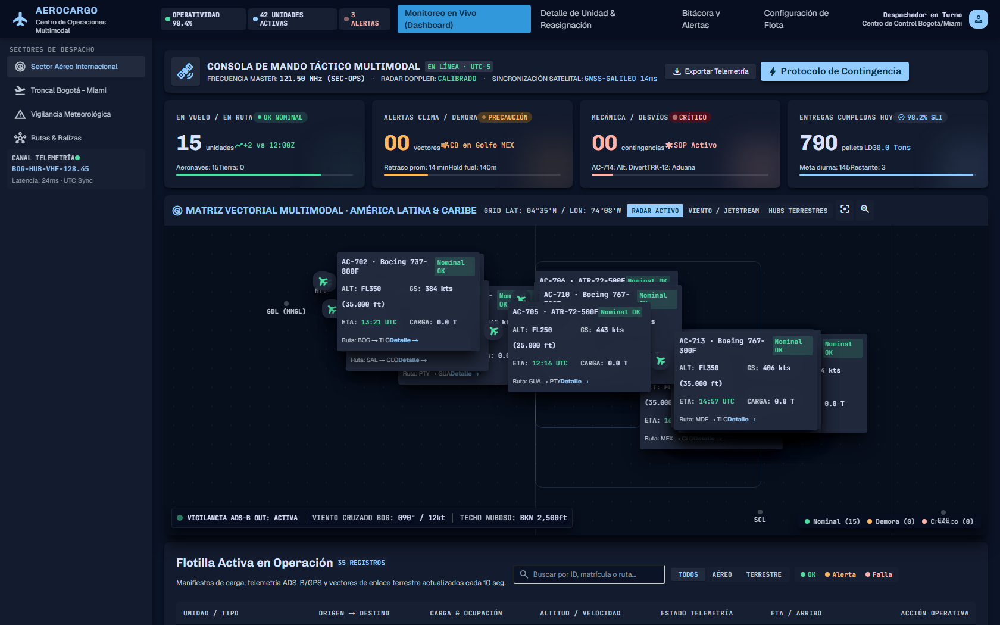
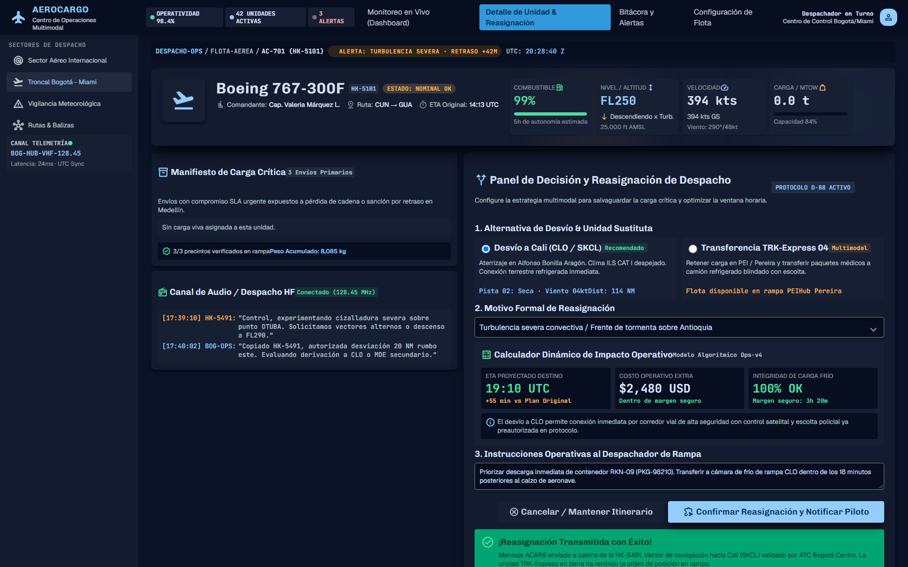
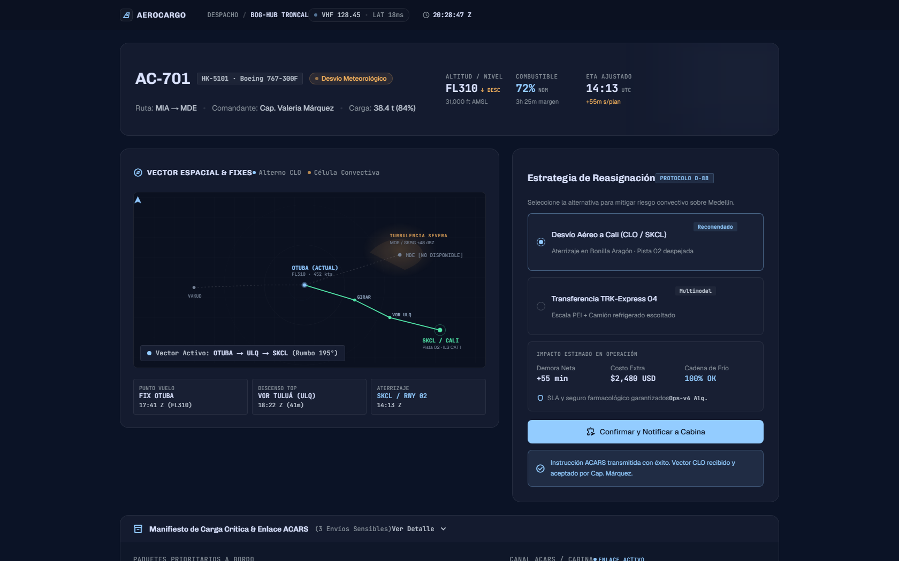
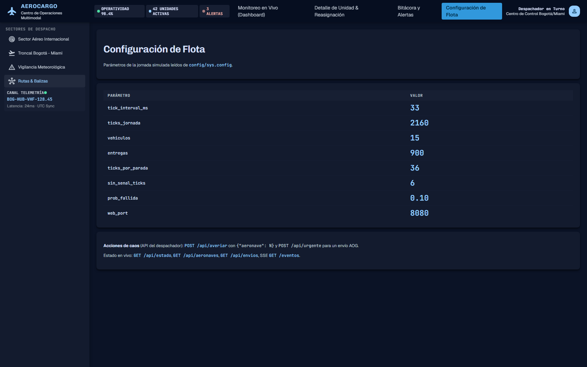

# AeroCargo — Flotilla Multimodal de Transporte Aéreo

> **Proyecto #29** — Simulación de despacho multimodal de carga aérea y terrestre con telemetría en tiempo real, reasignación automática y panel de operaciones táctico.

**Dominio:** aviación y transporte multimodal (aéreo internacional + troncal terrestre + última milla)  
**Stack:** Erlang/OTP 25+ (retrocompatible), rebar3, Cowboy 2.12, Prometheus 4.11, Thoas/JSON, HTML/CSS/JS plano (sin frameworks) servido por Cowboy  
**Diseño visual:** Export de Google Stitch "AeroCargo Telematics & Dispatch Operations" — dark slate, tipografía Chivo/Geist/JetBrains Mono, semántica táctica tricolor (Esmeralda/Ámbar/Carmesí)

---

## Tabla de contenidos

- [Arquitectura OTP](#arquitectura-otp)
- [Comandos de desarrollo](#comandos-de-desarrollo)
- [API y Endpoints web](#api-y-endpoints-web)
- [Diseño visual (Stitch)](#diseño-visual-stitch)
- [Pantallas implementadas](#pantallas-implementadas)
- [Supuestos y cifras verificadas](#supuestos-y-cifras-verificadas)
- [Prueba de caos](#prueba-de-caos)
- [Despliegue en Raspberry Pi](#despliegue-en-raspberry-pi)
- [Referencias](#referencias)

---

## Arquitectura OTP

```
p29_sup (rest_for_one)
├── p29_datos           (gen_server: tablas ETS de solo lectura p29_envios / p29_aeronaves)
├── p29_reloj           (gen_server: único dueño del tiempo; emite {p29_tick, N})
├── p29_ruta_vectorial  (gen_server: rutas vectoriales waypoint-a-waypoint, Great Circle)
├── p29_meteo           (gen_server: frentes tormentosos, CBs, turbulencia, viento en altura)
├── p29_adsb            (gen_server: simulación ADS-B OUT 1090 MHz cada 10s)
├── p29_adsb_receptor   (gen_server: receptor ADS-B, correlación con flota)
├── p29_despachador     (gen_server: asigna, reasigna, watchdog de señal, averías, urgencias)
├── p29_aeronaves_sup   (simple_one_for_one: un gen_server p29_aeronave por unidad)
├── p29_envios_sup      (simple_one_for_one: un gen_statem p29_envio por envío)
├── p29_transbordo_sup  (simple_one_for_one: transbordos en hubs)
├── p29_broadcaster     (gen_server: único suscriptor del reloj; difunde instantáneas a SSE)
└── p29_web             (gen_server: listener cowboy — estáticos, /api/*, /eventos, /metrics)
```

### Por qué `rest_for_one` y este orden

Las dependencias arrancan en orden: sin tablas no hay filas que escribir, sin reloj no hay ticks, sin rutas no hay plan de vuelo, sin meteo no hay alertas, sin ADS-B no hay telemetría, sin despachador nadie organiza, y solo entonces existen aeronaves y envíos para quien ya hay quien los ordene. Si algo intermedio cae, todo lo que depende de él se re-arranca en bloque.

### Reglas de dominio inmutables

- **ETS es caché de lectura**: el dueño de cada fila es el `gen_statem` del envío o el `gen_server` de la aeronave. Nunca escribas ETS desde otro proceso ni desde handler HTTP; usa la API (`p29_envio:*`, `p29_despachador:*`).
- **Reloj único**: `p29_reloj` es el único dueño del tiempo. Nada de `erlang:monotonic_time/0` ni `timer:sleep` en el dominio: rompe reproducibilidad y tests con reloj manual.
- **Determinismo**: flota, pesos, rutas y ventanas salen de `erlang:phash2`, no de `rand`. Meter `rand` sin semilla hace fallar `simulador_test_`.
- **Jornada desde T0**: el simulador cuenta desde el tick en que arranca (`T0 = tick_actual()`), no desde 0 absoluto. La avería/urgente se inyectan con `>=` una sola vez.
- **Despachador atrapa salidas** (`trap_exit`) y detecta muertes por monitores `'DOWN'`; las unidades se relanzan bajo `p29_aeronaves_sup`. Si tocas el arranque, respeta `esperar_sup`.

---

## Comandos de desarrollo

Todos los comandos se ejecutan **desde la raíz del proyecto** (`C:\Users\Max\dev\erlang-proyectos\proyectos\29-flotilla-de-reparto`):

```powershell
rebar3 compile      # warnings_as_errors: un solo warning rompe el build
rebar3 eunit        # 12 casos en 9 escenarios (árbol, asignación, statem, avería, señal, caos, demo, web, adsb)
rebar3 ct           # 3 casos de integración (app completa: estáticos, /api/*, regresión SSE)
rebar3 shell        # web en :8080 + de aquí: p29_simulador:demo().
```

Un caso suelto:
```powershell
rebar3 eunit --test=p29_flotilla_de_reparto_tests:arbol_despues_de_arrancar_test_
```

La demo corre la jornada completa (2160 ticks GPS de 10 s simulados cada 33 ms, ~72 s reales), inyecta avería al ~46% y pedido urgente al 75%, termina imprimiendo estado final.

---

## API y Endpoints web

| Ruta | Qué sirve |
|---|---|
| `/` | Dashboard: KPIs tácticos, mapa vectorial GPS en vivo, flota activa con filtros, feed de alertas |
| `/unidad.html?id=N` | Ficha de aeronave + botón de caos *inyectar avería* + panel de reasignación + radar + ACARS |
| `/historial.html` | Bitácora de telemetría y alertas con filtros tácticos, exportación IFR |
| `/api/aeronaves` | JSON de la flota con terminología AeroCargo |
| `/api/envios` | JSON de envíos con terminología AeroCargo |
| `/api/vehiculos` | **Backward compat** - alias de `/api/aeronaves` |
| `/api/entregas` | **Backward compat** - alias de `/api/envios` |
| `/api/estado` | Resumen + invariantes (`aeronaves`, `envios`, `reasignaciones`, `transbordos`, `retraso_medio`) |
| `/api/averiar` | **POST** `{"aeronave": N}` o `{"unidad": N}` — inyecta avería/desvío |
| `/api/urgente` | **POST** — alta de envío urgente AOG (nueva + legacy terminology) |
| `/eventos` | SSE: un evento `estado` por tick con resumen + instantánea de unidades |
| `/metrics` | Prometheus (gauges `p29_flotilla_*` + métricas de VM) |

### Métricas Prometheus (nuevas familias AeroCargo)

```prometheus
# Nuevas familias AeroCargo
p29_flotilla_aeronaves{estado="en_ruta|en_tierra|critico|alerta"}
p29_flotilla_envios{estado="pendiente|en_ruta|entregada|fallida|desviada"}
p29_flotilla_transbordos_total

# Backward compat (se mantienen para dashboards existentes)
p29_flotilla_vehiculos{estado="en_ruta|en_tierra"}
p29_flotilla_entregas{estado="pendiente|en_ruta|entregada|fallida"}
p29_flotilla_retraso_medio
p29_flotilla_reasignaciones_total
```

---

## Diseño visual (Stitch)

### Paleta táctica (source of truth: `design/stitch_aerocargo/aerocargo_telematics_dispatch_operations/DESIGN.md`)

```css
/* Superficies */
--canvas-default:     #0B1120;  /* Negro Espacial Profundo */
--surface-base:       #0F172A;  /* Azul Pizarra Base */
--surface-elevated:   #1E293B;  /* Pizarra Elevada / Contenedores */
--surface-overlay:    #334155;  /* Bordes activos, divisores */

/* Marca y acción */
--primary:            #0284C7;  /* Azul Vector */
--primary-active:     #38BDF8;  /* Luz de radar / Foco */

/* Semántica táctica (estricta) */
--status-ok:          #10B981;  /* Esmeralda Operativa: nominal, a tiempo, GPS estable */
--status-warning:     #F59E0B;  /* Ámbar Radar: meteo moderada, retraso, recalibración */
--status-critical:    #EF4444;  /* Carmesí Alerta: desvío, falla crítica, emergencia */
--status-info:        #38BDF8;  /* Cian Aviónica: balizas, aproximación, telemetría pasiva */

/* Texto */
--text-primary:       #F8FAFC;
--text-secondary:     #94A3B8;
--text-muted:         #64748B;
```

### Tipografía

- **Chivo** (600/700): Headers, títulos de sección, alertas
- **Geist** (400/500/600): UI, datos de manifiesto, cuerpo
- **JetBrains Mono** (500/700): Coordenadas, telemetría, contadores, códigos

### Componentes clave

1. **Botones Tácticos**: Primario (Azul Vector), Crítico (Carmesí), Secundario (Filtro)
2. **Badges/Chips de estado**: NOMINAL (verde + punto), ALERTA (ámbar + pulso lento), CRÍTICO (carmesi + pulso 1Hz)
3. **Tarjeta de Aeronave**: Chasis `#1E293B`, cabecera ID + ruta + badge, cuadrícula 3x1 telemetría (FL, GS, Payload), mini-barra de progreso de ruta
4. **Inputs/Selects**: Fondo `#0B1120`, foco con glow `#0284C7`, selectores de flota agrupados por sector
5. **Lista de Eventos de Despacho**: Filas alternadas, timestamp monoespaciado UTC/Local, código evento, mensaje, acción rápida
6. **Mapa Vectorial (Canvas)**: Grid táctico, anillos concéntricos, rutas con gradientes semánticos, pins interactivos con ficha telemetría

---

## Pantallas implementadas

| Archivo | Pantalla | Descripción |
|---|---|---|
| `priv/static/index.html` | Dashboard | Consola de mando, 4 KPIs tácticos, mapa vectorial multimodal, tabla de flota activa con filtros, terminal de alertas |
| `priv/static/unidad.html` | Detalle Aeronave | Cabecera aeronave, 6 gauges telemetría (Altitud, Vel. Tierra, Heading, V/S, Combustible, Carga Útil), manifiesto crítico, panel decisión reasignación (radio options + calculador impacto), mapa radar con fixes de decisión, intercom ACARS |
| `priv/static/unidad-enfocada.html` | Detalle Enfocado | Variante de foco de la ficha de unidad: una sola aeronave a pantalla completa, para seguir un desvío o una avería en la demo |
| `priv/static/historial.html` | Bitácora/Alertas | Filtros tácticos (búsqueda, severidad, ventana temporal, segmento), 3 KPIs (MTTR, OTP, Safety), stream cronológico de eventos con modales GPS/Reasignación, export IFR |
| `priv/static/configuracion.html` | Configuración | Panel de parámetros de la simulación y de las familias Prometheus, sin tocar `sys.config` a mano |

Las cinco pantallas se generan desde las maquetas de Stitch con `tools/stitch_port/port.py` y se hidratan con `priv/static/app.js` (dispatcher por `body[data-page]`).

### Capturas de la app real (RPi, 2026-11-11)

Tomadas con Chromium headless (Playwright) contra el release desplegado en la RPi a través de un túnel SSH a `:8080`, con la jornada en marcha (no son maquetas).

| Pantalla | Captura |
|---|---|
| Dashboard |  |
| Detalle aeronave |  |
| Detalle enfocado |  |
| Bitácora / alertas |  |
| Bitácora con modal de reasignación |  |
| Configuración |  |

Defectos de UI que muestran las capturas y todavía no están corregidos: la cabecera del dashboard dice «42 UNIDADES ACTIVAS» fijo mientras el KPI dice 15, y `configuracion.html` lee las claves legacy `vehiculos`/`entregas` (ver «Código legacy»).

### Optimizaciones de rendimiento (app.js)

- **requestAnimationFrame** para todas las actualizaciones visuales (batched rendering at max 2Hz)
- **Dirty flag system** - solo re-renderiza lo que cambió realmente
- **SSE throttled** (500ms mínimo entre lotes de procesamiento)
- **Canvas-based radar** (60fps capable vs SVG DOM thrashing)
- **Virtualized fleet list** - solo renderiza items visibles + buffer
- **Event delegation** - single listener vs per-element listeners
- **DOM reuse / element pooling** - no innerHTML replacement en cada tick
- **Projection cache** - transformadas de coordenadas memoizadas
- **Formatter caches** - formateo de números/fechas memoizado
- **Proper cleanup** - animation frames, event listeners, caches on unload
- **Visibility change handling** - pausa rendering cuando tab hidden

**Resultado:** Elimina congelación de botones, asegura respuesta inmediata de UI bajo carga pesada de datos SSE.

---

## Supuestos y cifras verificadas

La consigna pide separar lo que viene del enunciado de lo que asumimos nosotros, y verificar las fuentes vivas antes de citar cifras. Esto es lo que usa esta implementación.

### Cifras del enunciado

| Cifra | Valor usado | Dónde vive | Verificación |
|---|---|---|---|
| Última milla = más de la mitad del costo del envío | 53 % del costo total (2023) | Contexto, no parámetro | **Verificado**: World Economic Forum, *Transforming Urban Logistics* (2024), p. 4: 53 % en 2023, desde 41 % en 2018 |
| Entregas fallidas | 5–15 % → **10 %** | `prob_fallida` en `config/sys.config` | Enunciado. Contraste: fallo en primer intento 8–20 % (FreightWaves/HBR, recogido por SmartRoutes 2024) y 8 % en reparto doméstico (Enterprise Times, 2021). El 10 % elegido cae dentro de ambos rangos |
| Entregas por unidad y día | 60–150 → **60** (900 envíos / 15 unidades) | `envios` y `aeronaves` en `sys.config` | Enunciado. Se toma el extremo bajo porque la jornada simulada es de 6 h, no de un turno completo |
| Tiempo por parada | 2–5 min → **6 min** | `ticks_por_parada = 36` (36 × 10 s) | Enunciado. El modelo suma conducción entre waypoints, por eso queda por encima del rango de servicio puro |
| Telemetría GPS | cada 5–15 s → **10 s** | `tick_interval_ms = 33` + 1 tick = 10 s simulados | Enunciado |
| Ventanas de entrega ("entre 2 y 4 pm") | ventanas de **1–3 h** repartidas en la jornada | `p29_despachador:ventana_aleatoria/1` | Enunciado. Duraciones menores generaban un retraso medio irreal (ver «Modelo de ventanas») |
| VRP es NP-difícil: solución buena y rápida | **greedy first-fit**, O(envíos × unidades) por pasada | `p29_despachador` | Enunciado |
| Escenario | 15 unidades, 900 envíos, avería a las 11 a. m. (46 % de la jornada), urgente a media jornada (75 %) | `sys.config` + `p29_simulador` | Enunciado |

### Supuestos propios

1. **Jornada de 6 h (08:00–14:00) = 2160 ticks** de 10 s, comprimida a ~33 ms por tick (×300). La jornada termina en `ticks_jornada`; la simulación sigue drenando la cola, como un día real con entregas en vuelo.
2. **Pivot aéreo**: el escenario original es de última milla terrestre. Se conserva la topología (unidades, envíos, reasignación, ventanas, capacidad) y se cambia el vehículo por flota AeroCargo (B767, B737, ATR-72, B777, A330) con waypoints IATA y rutas Great Circle.
3. **Capacidad por tipo de aeronave** (kg de bodega). Si el envío no cabe, queda `pendiente` en cola y se reintenta cada `ticks_por_parada`; solo es `fallida/sin_cupo` si ningún tipo de la flota cubre la ruta.
4. **Fallo de entrega**: 10 % determinista por `phash2(id)`. El envío fallido **no** se reprograma (no hay segundo intento). Es una simplificación consciente: modelar el reintento duplicaría el costo sin cambiar la lección de reasignación.
5. **Desvío por meteo**: `prob_desvio` devuelve el envío a `pendiente` (nunca directo a `fallida`), para que el despachador lo reasigne.
6. **Un hub por ruta**; el transbordo ocurre en el waypoint intermedio con mayor ahorro y se registra en la tabla de transbordos.
7. **Hueco de conectividad**: `sin_senal_ticks = 6` (60 s sin GPS) dispara alerta y reasignación; al reconectar se descarta el reporte más viejo (el más nuevo manda).
8. **Determinismo total**: flota, pesos, rutas, ventanas y fallos salen de `erlang:phash2`, nunca de `rand`. La misma corrida produce las mismas cifras.

### Modelo de ventanas (corregido 2026-11-11)

Las ventanas se generaban en los ticks 20–408 sobre una jornada de 2160, así que casi toda entrega quedaba "tarde" contra una ventana que había cerrado en el primer 19 % del día, y `retraso_medio` trepaba a ~972 ticks (2.7 h). Ahora `ventana_aleatoria/1` reparte el inicio sobre `ticks_jornada` con duración de 1–3 h.

### Corrida de referencia (RPi 4, OTP 27.3.4.19, `config/sys.config`)

| Métrica | Valor |
|---|---|
| Entregadas / fallidas | 814 / 87 sobre 901 envíos (90.3 % / 9.7 %) |
| Reasignaciones | 23 |
| Retraso medio | **73 ticks ≈ 12 min** |
| Invariantes | `ok` |
| Transbordos | 0 en esta corrida (el escenario no fuerza un hub intermedio) |

---

## Prueba de caos

Se mató un proceso de cada capa con `exit(Pid, kill)` contra la app real y se midió qué pasó. Detalle completo, comandos de reproducción y salida cruda en [`docs/prueba-de-caos.md`](docs/prueba-de-caos.md).

| Qué se mató | Qué se esperaba | Qué ocurrió |
|---|---|---|
| `p29_aeronave` (unidad 3) | El supervisor la relanza vacía; el despachador reasigna su carga | Recreada en **101 ms**; `invariantes: ok`; la entrega siguió avanzando |
| `p29_envio` (gen_statem) | El despachador detecta el `'DOWN'` y reasigna; el supervisor relanza el proceso | Reasignación +1; 900 hijos vivos; `invariantes: ok` |
| `p29_despachador` | `rest_for_one` reinicia despachador y todo lo que está después | Reiniciado en **101 ms**, pero **la jornada vuelve a empezar** (entregadas 357 → 12): el estado vive en los procesos hijos, no en ETS |
| `p29_web` | La web es un observador: cae sola y el dominio sigue | HTTP 200 de nuevo en **24 ms**; entregadas 354 → 366 sin pausa |
| `p29_datos` | Dueño de las tablas ETS: `rest_for_one` reinicia todo el árbol | Todo el árbol arriba en **101 ms**; simulación desde cero (tick 61), `invariantes: ok` |

**Conclusión honesta**: el árbol sobrevive a cualquier muerte y nunca deja envíos huérfanos ni duplicados (`invariantes: ok` en los cinco casos). La debilidad conocida es que el estado de la jornada es **en memoria**: perder `p29_datos` o `p29_despachador` reinicia la simulación. Para una demo es aceptable; para producción pediría persistencia o un árbol que aísle el estado del dominio.

---

## Despliegue en Raspberry Pi (producción)

- Repo en `~/erlang-proyectos` (clon GitHub). Se edita/empuja desde Windows y allí `git pull --ff-only`; no hay credenciales git en el Pi.
- `ssh flotilla 'comando'` **no** carga asdf (bash no interactivo): prefija `export PATH=$HOME/.asdf/shims:$HOME/bin:$PATH` o usa `bash -lc '...'`.
- **Comillas dobles y contrabarras mueren en PowerShell→ssh**: para mandar JSON desde Windows, escríbelo en el Pi sin comillas dobles en la línea, con `printf` octal y contrabarras dobladas:
  `printf '\\173\\042aeronave\\042\\0727\\175' > /tmp/u.json; curl -s -X POST -H 'Content-Type: application/json' --data @/tmp/u.json ...`
- `sudo` sin contraseña; 26 GB libres; deps en `_build` ya bajadas.
- Antes de dar por desplegado: `rebar3 compile` y `rebar3 eunit` **en el Pi**; OTP/aarch64 puede comportarse distinto que Windows.
- `config/vm.args` fija `+S 4:4`: nunca más schedulers que cores físicos.
- `config/sys.config` lleva envs de demo (waypoints, FL, kts, payload tons, SLA ventanas, meteo), no secretos; la cookie **no** se versiona: `vm.args` usa `-setcookie ${P29_COOKIE}` y el valor real vive en `/etc/p29-flotilla.env` (chmod 600, `EnvironmentFile` de la unidad, `RELX_REPLACE_OS_VARS=true`).
- Servicio corre release de **`_build/default/rel/`** (ver `deploy/p29-flotilla.service`), NO `_build/prod/rel/`: `rebar3 release` y comprobar binario en `systemctl status`. Reconstruir sin reiniciar servicio deja en `:8080` release viejo con estáticos viejos.
- Cotejo rápido Pi vs local (lectura vía `ssh flotilla`):
  `md5sum priv/static/app.js src/p29_json.erl config/sys.config` en ambos lados
  `git rev-parse HEAD` en ambos
  En Pi: `curl -s -o /dev/null -w '%{time_total}' http://127.0.0.1:8080/api/aeronaves` para separar "lento en navegador" (~12ms en Pi) de "lento por proxy Corellium".

---

## Referencias

- **Repo original (especificación base)**: https://github.com/tectijuana/erlang-proyectos/tree/main/proyectos/29-flotilla-de-reparto
- **Fork con trabajo actual (AeroCargo)**: https://github.com/l23211974-maker/erlang-proyectos/tree/main/proyectos/29-flotilla-de-reparto
- **Manual Pi + métricas (gist)**: https://gist.github.com/l23211974-maker/f754a5fa477b148f2cdc2f36a10a76a8
- **Documento "Importancia de Erlang"**: https://gist.github.com/l23211974-maker/7aa4a94d57b4eb7b17b89f21d18928cb
- **Diseño Stitch AeroCargo**: `C:\Users\Max\Downloads\stitch_gestor_de_flotilla_a_rea.zip` (descomprimido en `design/stitch_aerocargo/`)

---

## Próximos pasos

**Hecho**

- ~~Desplegar en Pi~~: release autocontenido (ERTS embebido), `systemd`, métricas y SSE en vivo verificados en la RPi.
- ~~Supuestos y cifras verificadas~~: sección propia en este README, con las fuentes del enunciado contrastadas.
- ~~Prueba de caos~~: cinco escenarios con evidencia en [`docs/prueba-de-caos.md`](docs/prueba-de-caos.md).
- ~~Modelo de retraso~~: ventanas repartidas sobre la jornada; `retraso_medio` ≈ 12 min en vez de 2.7 h.
- ~~Endurecer systemd~~: `Restart=always`, `StartLimit`, `NoNewPrivileges`, `PrivateTmp`, `ProtectSystem=full`, timeouts y logrotate (`deploy/`). Verificado en la RPi: `KILL` → arriba en 12 s con HTTP 200.
- ~~Cookie fuera del repo~~: `-setcookie ${P29_COOKIE}` sustituido por relx en runtime; la cookie vive en `/etc/p29-flotilla.env` (chmod 600). Verificado: cookie nueva `pong`, la vieja `pang`.
- ~~Verificar OTP 25~~: job `test-p29-otp25` del CI (compile + eunit + ct en OTP 25), porque `curso-plf` ya no está disponible.
- ~~Capturas~~: seis capturas reales en [`docs/capturas/`](docs/capturas) enlazadas arriba.

**Pendiente**

1. **Tests de caos automatizados**: los cinco escenarios de `docs/prueba-de-caos.md` corren a mano; pasarlos a `p29_flotilla_ct_SUITE` (pérdida de señal ADS-B por sector, meteo severa generalizada, fallo de hub principal).
2. **Cobertura de dominio**: `p29_meteo`, `p29_transbordo` y `p29_ruta_vectorial` no tienen test directo (sí se ejercitan desde `eunit`/`ct`).
3. **Estrangular el SSE** cuando termina `ticks_jornada` (hoy sigue a 30 Hz con la flota idle).
4. **Seguridad restante**: contraseña por defecto del Pi (`pi`/`raspberry`); la cookie ya no está en el repo.
5. **Código legacy**: `p29_vehiculo`, `p29_entrega`, `p29_flota_sup` y `p29_entregas_sup` ya no están en el árbol de supervisión (quedaron del pivot tierra→aire); decidir si se borran o se marcan `deprecated`. `configuracion.html` todavía lee las claves legacy `vehiculos`/`entregas`.
6. **UI**: la cabecera del dashboard muestra «42 UNIDADES ACTIVAS» fijo en vez del conteo real.

---

## Notas para el agente

- **No dupliques lógica**: usa los módulos existentes como base; el pivot es semántico (tierra→aire), la arquitectura OTP se mantiene.
- **Respeta OTP 25**: cualquier cambio debe compilar y pasar tests en OTP 25 (curso-plf) y OTP 27+ (local/Pi).
- **Tokens de diseño**: toma colores, tipografía, espaciado, componentes del `DESIGN.md` de Stitch; no inventes valores.
- **SSE bajo carga**: el diagnóstico 2026-11-08 sigue válido — desacopla pintado del tick (rAF + bandera), no refetchees `/api/aeronaves` por tick, reusa mapa, estrangula SSE tras jornada.
- **PowerShell 5.1 en Windows**: escribe archivos UTF-8 sin BOM; usa `bash -s` con heredoc para comandos remotos ssh.
- **Segundo Cerebro**: al cerrar sesión, crea/actualiza nota en `C:\Users\Max\Desktop\obsidian\Maximiliano\Sesiones/` y enlaza desde `MOC_SegundoCerebro.md`.